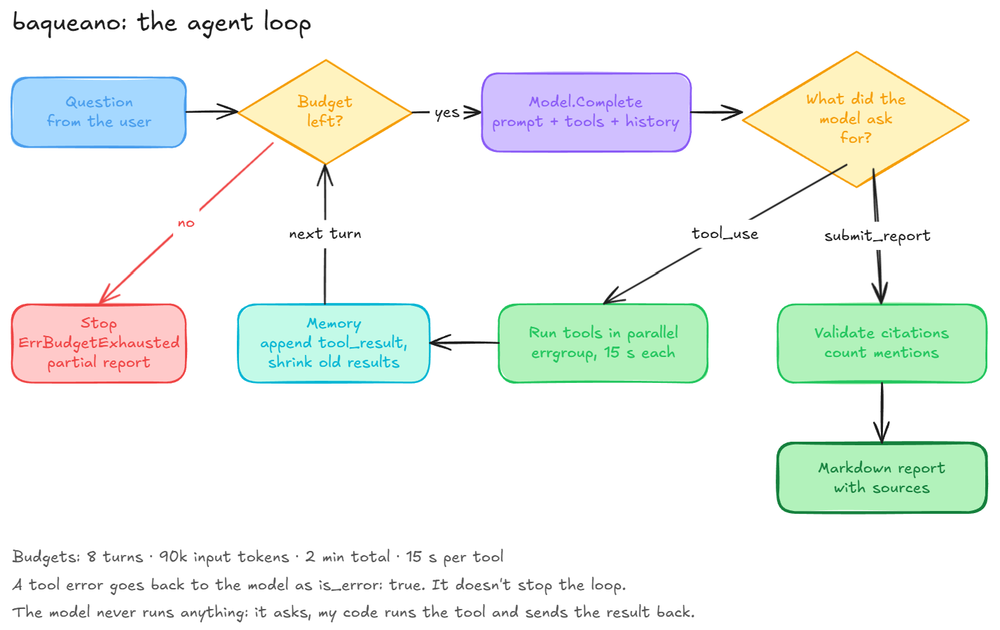
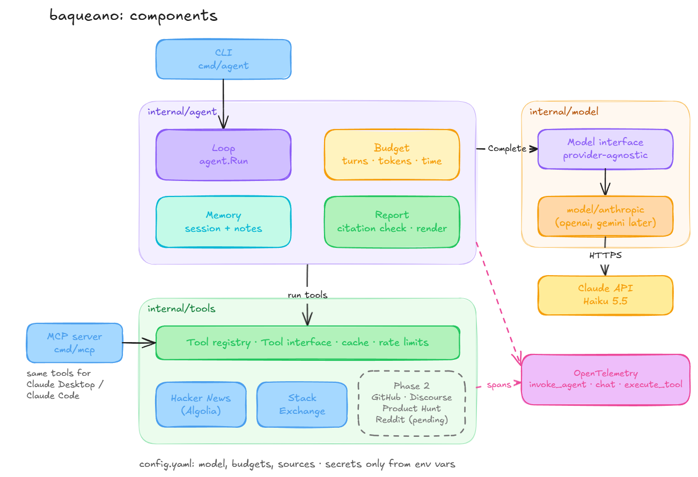
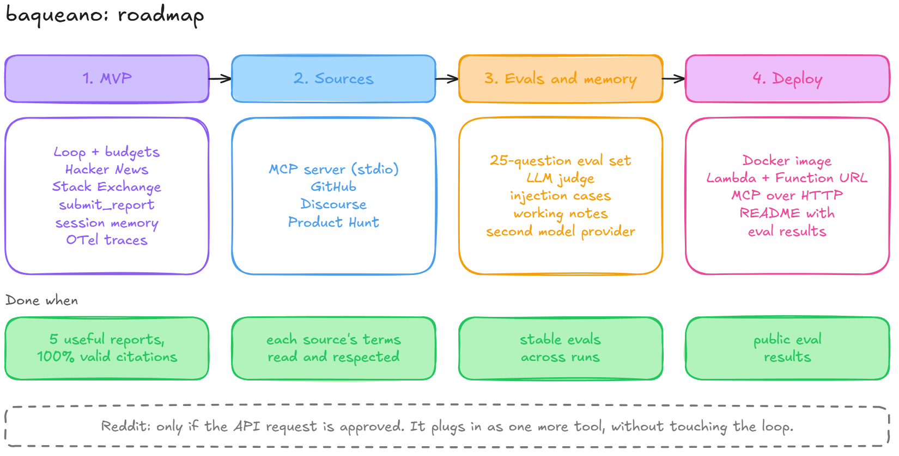

# baqueano

A research agent in Go that finds real problems people report online and returns a cited report.

You ask it something like *"what problems do people have with Terraform state?"*. It searches communities where people describe what goes wrong for them (Hacker News, Stack Exchange, and later GitHub and Discourse forums), reads the threads that look relevant, and gives back a report: the problems it found, how many documents mention each one, how people work around them today, and a link to every source.

I'm building it for two reasons: to check product and project ideas before I spend time on them, and to learn how to build agents from scratch instead of only using them.

> **Status:** design phase. The full design is in [docs/DESIGN.md](docs/DESIGN.md). Code for phase 1 is next.

## How it works



The model doesn't run anything and doesn't remember anything between calls. It only asks for tools; my code runs them and sends the results back. The agent is that back-and-forth in a loop:

1. Send the question, the system prompt and the tool definitions to the Claude API.
2. If the model asks for tools (`stop_reason: tool_use`), run them in parallel and send back the results.
3. Repeat until the model hands in the report through a `submit_report` tool, or a budget runs out (8 turns, 2 minutes, 90k input tokens).
4. Check that every citation in the report points to a document the tools actually returned, count mentions per problem (documents, authors and threads), and render Markdown. There's [a full example](docs/REPORT-EXAMPLE.md) built by hand with real data.



## What makes it different

- **My own loop, no agent framework.** Written against a small `Model` interface, so it's testable with a fake model and the model can change without touching the loop.
- **Verifiable citations.** Every document has a stable ref like `hn:41234567`. A ref that never appeared in a tool result is an error, not a footnote.
- **Mentions are counted in code, not by the model.** That number decides what's at the top of the report.
- **Hard budgets** on turns, tokens, time and cost.
- **Context management:** tools return excerpts, old results get shrunk, and compaction is the last resort.
- **OpenTelemetry traces** with the GenAI semantic conventions: one span per model call and per tool call.
- **Evals:** a fixed question set, run offline against recorded responses, to compare prompts, models and memory strategies.
- **Read-only and polite:** public APIs only, no scraping, a 1-hour in-memory cache, per-source rate limits, nothing used for training.

## Sources

| Source | Access | Phase |
| --- | --- | --- |
| Hacker News (Algolia API) | No key | 1 |
| Stack Exchange API v2.3 | Optional free key | 1 |
| GitHub Issues and Discussions | Personal token | 2 |
| Discourse forums | Each forum's public JSON | 2 |
| Product Hunt API v2 | Developer token, non-commercial | 2 |
| Reddit | Pending API approval | — |

Endpoints, filters and limits for each one are in [docs/DESIGN.md](docs/DESIGN.md#appendix-sources-in-detail).

## Planned usage

Not implemented yet; this is the target interface.

```bash
export ANTHROPIC_API_KEY=...

# Ask a question, get a Markdown report
go run ./cmd/agent "what problems do people have with Terraform state?"

# Or expose the same tools to Claude Desktop / Claude Code over MCP (stdio)
go run ./cmd/mcp
```

Configuration lives in `config.yaml` (model, budgets, enabled sources). Secrets only come from environment variables.

## Stack

Go · Claude API (`anthropic-sdk-go`, Haiku 5.5 by default; other providers plug in through the `Model` interface) · MCP Go SDK · OpenTelemetry · Docker · AWS Lambda (phase 4)

## Roadmap



| Phase               | Scope                                                                                    | Done when                                                              |
|---------------------|------------------------------------------------------------------------------------------|------------------------------------------------------------------------|
| 1. MVP              | Loop,  budgets, Hacker News, Stack Exchange, `submit_report`, session memory, traces     | The 5 phase 1 eval cases give useful reports with 100% valid citations |
| 2. Sources          | MCP server, GitHub, Discourse, Product Hunt                                              | Each source's terms read and respected                                 |
| 3. Evals and memory | 25-question eval set, LLM judge, injection cases, working notes, a second model provider | Stable evals across runs                                               |
| 4. Deploy           | Lambda with a Function URL, MCP over HTTP                                                | Public eval results                                                    |

## Docs

- [docs/DESIGN.md](docs/DESIGN.md): the full design, with every decision explained. It starts from what an agent is and covers the loop, system prompt, tools, Go code, memory, security, observability, tests, evals and deploy.
- [docs/REPORT-EXAMPLE.md](docs/REPORT-EXAMPLE.md): a report I built by hand with real Hacker News data, from the `submit_report` input to the final Markdown. It's the target for phase 1.
- [docs/EVALS.md](docs/EVALS.md): the 25 eval cases, how they're scored, the judge's rubric and how recorded responses are replayed.

## License

[Apache License 2.0](LICENSE).