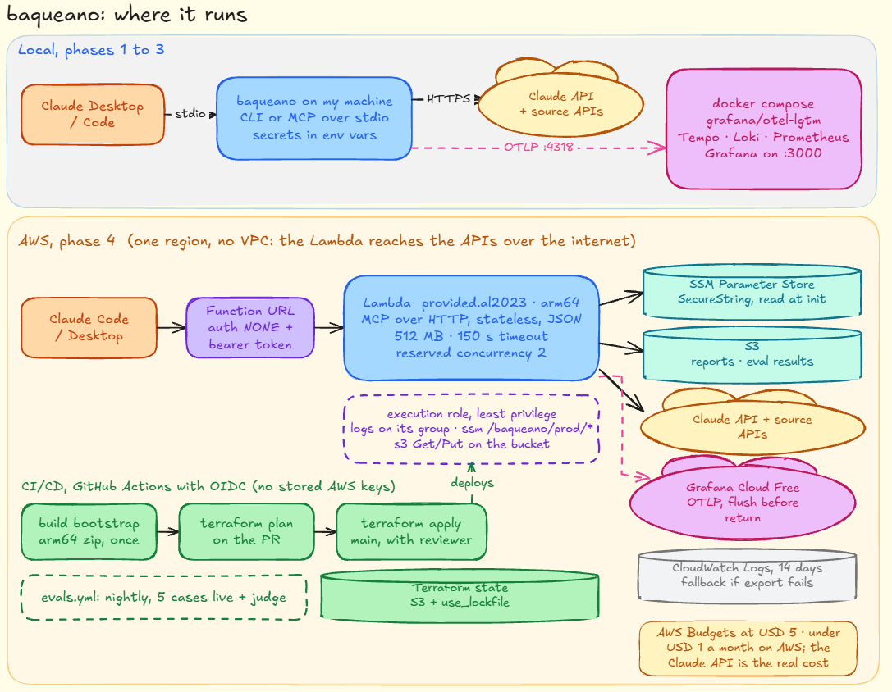
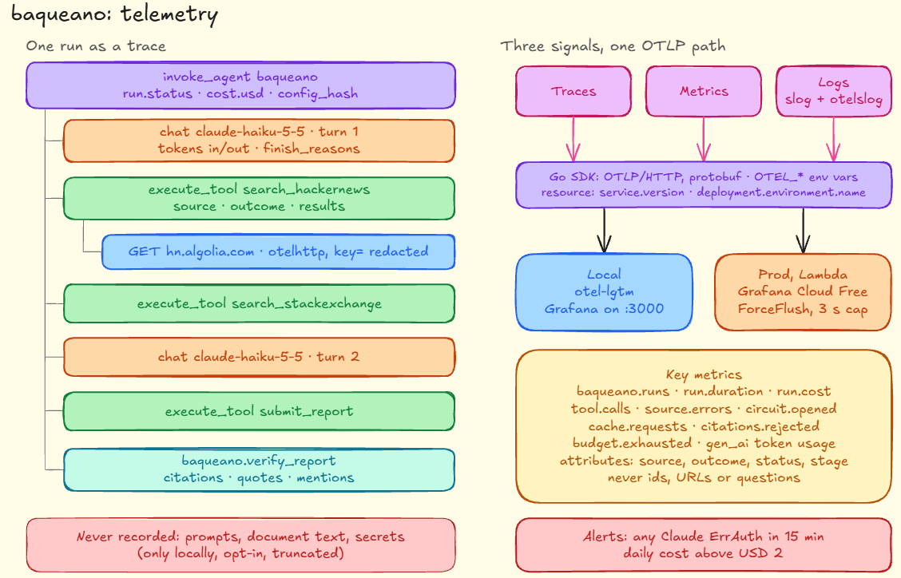

# baqueano: infrastructure, configuration, observability and testing

This document covers where baqueano runs and how I operate it: local development with Docker, the AWS setup for phase 4, Terraform, how configuration loads, the full telemetry inventory (traces, metrics, logs), the test strategy and CI. [DESIGN.md](DESIGN.md) describes the agent itself; [EVALS.md](EVALS.md) covers the AI evals; the [decision records](adr/README.md) have the options I weighed.

Everything here is sized for what baqueano is: one user, a few questions a day plus eval runs, and runs of up to 2 minutes. If that changes, several of these decisions change too, and I say which ones at the end.

## Contents

1. [The short version](#the-short-version)
2. [Local development with Docker](#local-development-with-docker)
3. [Production on AWS](#production-on-aws)
4. [Infrastructure as code](#infrastructure-as-code)
5. [Configuration](#configuration)
6. [Observability](#observability)
7. [Tests](#tests)
8. [CI/CD](#cicd)
9. [By phase](#by-phase)
10. [What I still have to check](#what-i-still-have-to-check)
11. [Sources](#sources)

## The short version

| Area          | Decision                                                                                                                    | Why, in one line                                                                                |
|---------------|-----------------------------------------------------------------------------------------------------------------------------|-------------------------------------------------------------------------------------------------|
| Local backend | Docker Compose with `grafana/otel-lgtm`                                                                                     | One container with collector, Tempo, Loki, Prometheus and Grafana: the same stack I use in prod |
| Image         | Multi-stage build, Go cross-compiles per arch, `distroless/static:nonroot`                                                  | No QEMU, CA certificates included, non-root                                                     |
| Compute       | AWS Lambda, `provided.al2023`, arm64, zip                                                                                   | Zero cost when idle; my volume fits in the always-free tier                                     |
| HTTP entry    | Lambda Function URL, no API Gateway                                                                                         | API Gateway's HTTP APIs stop at 29 seconds; my runs take up to 2 minutes                        |
| Remote MCP    | Official Go SDK, Streamable HTTP, stateless, JSON responses                                                                 | Each invocation can land on a different instance, and my tools hold no state                    |
| Auth          | Bearer token checked in the handler; OAuth 2.1 when there's more than one user                                              | Claude Code can send a header; IAM auth needs SigV4, which MCP clients don't do                 |
| Secrets       | SSM Parameter Store SecureString, read once at init                                                                         | Free for standard parameters; I rotate keys by hand, so Secrets Manager adds nothing            |
| Storage       | One S3 bucket for reports and eval results; no DynamoDB                                                                     | The cache and limiters are per process, and with low reserved concurrency that's enough         |
| IaC           | Terraform (OpenTofu-compatible), S3 state with native locking                                                               | The industry standard, and the lock no longer needs a DynamoDB table                            |
| CI/CD         | GitHub Actions with OIDC to AWS, GoReleaser for releases                                                                    | No long-lived AWS keys anywhere                                                                 |
| Config        | Standard library + YAML, four layers, `Validate()`, `config_hash`                                                           | Four fixed layers don't need a library                                                          |
| Traces        | Manual spans with the GenAI semantic conventions, `otelhttp` for sources                                                    | Spans for my loop, my names, one package to update when the conventions change                  |
| Metrics       | GenAI client metrics plus low-cardinality `baqueano.*` metrics                                                              | Cost, errors per source and budgets at a glance                                                 |
| Logs          | `log/slog` JSON to stderr, plus the `otelslog` bridge                                                                       | Logs correlated with traces                                                                     |
| Collector     | Locally, the one inside `otel-lgtm`. On Lambda, none: the SDK exports directly and flushes before returning                 | One service and one backend; a collector layer adds cold start and moving parts                 |
| Backend       | Grafana Cloud Free in prod, `otel-lgtm` locally                                                                             | Same queries and dashboards in both; far below the free limits                                  |
| Tests         | Table tests, fake `Model`, `httptest`, golden files, fuzzing, `-race`, `testing/synctest`, recorded fixtures, MCP in memory | Deterministic and fast; the model's behavior goes to the evals                                  |

What it costs on AWS at my volume: under USD 1 a month. The Claude API is the real cost by orders of magnitude.



## Local development with Docker

### The local backend

I want to see the trace, metrics and logs of a run seconds after it ends, without running four containers, and with the same OTLP code I use in prod. Prod is going to be Grafana (Tempo, Loki and Mimir), so local should look like it.

| Option                             | What it gives me                                                                     | Why I didn't pick it                                                                                                                 |
|------------------------------------|--------------------------------------------------------------------------------------|--------------------------------------------------------------------------------------------------------------------------------------|
| **`grafana/otel-lgtm`**            | OpenTelemetry Collector, Prometheus, Tempo, Loki, Pyroscope and Grafana in one image | Picked                                                                                                                               |
| Jaeger v2 (built on the Collector) | The best trace UI on its own                                                         | Traces only; metrics and logs need more pieces. Jaeger v1 reached end of life on December 31, 2025, so old tutorials no longer apply |
| Aspire Dashboard                   | Very light, nice UI for traces, logs and metrics                                     | Teaches me nothing about the prod backend; no PromQL or LogQL                                                                        |

`otel-lgtm` is heavy (the image is close to 900 MB) and Grafana says clearly it's for development, demos and testing. It's never the prod backend. The upside: dashboards I build locally export as JSON and load into Grafana Cloud almost unchanged.

### Compose

```yaml
# deploy/compose/docker-compose.yml
services:
  lgtm:
    image: grafana/otel-lgtm:<pinned tag>
    ports: ["3000:3000", "4317:4317", "4318:4318"]
    volumes: [lgtm-data:/data]

  # Only to try the MCP server over HTTP (phase 2 on). The CLI and stdio run on the host.
  baqueano-mcp-http:
    profiles: ["http"]
    build: { context: ../.., dockerfile: Dockerfile, args: { BIN: mcp } }
    command: ["--transport=http", "--addr=:8080"]
    ports: ["8080:8080"]
    env_file: ../../.env               # ANTHROPIC_API_KEY and friends; never committed
    environment:
      OTEL_EXPORTER_OTLP_ENDPOINT: http://lgtm:4318
      OTEL_EXPORTER_OTLP_PROTOCOL: http/protobuf
      OTEL_SERVICE_NAME: baqueano
      OTEL_RESOURCE_ATTRIBUTES: deployment.environment.name=local
    depends_on: [lgtm]

volumes:
  lgtm-data: {}
```

`docker compose up lgtm` is all phase 1 needs. Grafana is on `localhost:3000`, and a "baqueano run" dashboard is provisioned from `deploy/grafana/dashboards/`.

### The image

```dockerfile
# syntax=docker/dockerfile:1
ARG GO_VERSION
FROM --platform=$BUILDPLATFORM golang:${GO_VERSION} AS build
ARG TARGETOS TARGETARCH BIN=agent
WORKDIR /src
COPY go.mod go.sum ./
RUN --mount=type=cache,target=/go/pkg/mod go mod download
COPY . .
RUN --mount=type=cache,target=/root/.cache/go-build \
    CGO_ENABLED=0 GOOS=$TARGETOS GOARCH=$TARGETARCH \
    go build -trimpath -ldflags="-s -w" -o /out/baqueano ./cmd/${BIN}

FROM gcr.io/distroless/static-debian12:nonroot
COPY --from=build /out/baqueano /baqueano
ENTRYPOINT ["/baqueano"]
```

- The build stage runs on the builder's platform and Go cross-compiles for the target, so a multi-arch build (`linux/amd64`, `linux/arm64`) needs no QEMU.
- `GO_VERSION` comes from `go.mod` in CI, so the image and the module never disagree.
- `distroless/static` instead of `scratch`, because it already has CA certificates, tzdata and a `nonroot` user. A binary that talks HTTPS to five APIs needs the certificates.

### The CLI and MCP over stdio, outside Docker

Most of the time the binary runs on my machine, not in a container. It sends telemetry into the Compose stack with the standard variables:

```bash
export OTEL_EXPORTER_OTLP_ENDPOINT=http://localhost:4318
export OTEL_EXPORTER_OTLP_PROTOCOL=http/protobuf
export OTEL_SERVICE_NAME=baqueano
```

For Claude Desktop or Claude Code, the client starts the stdio server, so those variables go in the `env` block of the client's MCP config. Two things to keep in mind:

1. **stdout belongs to the protocol.** Over stdio, stdout carries JSON-RPC. Every log, every debug exporter and every stray `fmt.Println` goes to stderr or to OTLP. One line on stdout breaks the session.
2. **Shutdown.** The client kills the process when it closes. I use `signal.NotifyContext` and call `Shutdown` on the providers with a 2 to 3 second timeout. Losing the last span now and then is acceptable.

## Production on AWS

### Compute: Lambda

| Option                          | Cost at my volume                                                                     | Why                                                                                                                                   |
|---------------------------------|---------------------------------------------------------------------------------------|---------------------------------------------------------------------------------------------------------------------------------------|
| **Lambda with a Function URL**  | Zero: the always-free tier includes 1 million requests and 400,000 GB-seconds a month | Picked                                                                                                                                |
| ECS Fargate or ECS Express Mode | Pays 24/7 even when idle, plus a load balancer                                        | What I'd use if runs went past 15 minutes or I needed long SSE connections                                                            |
| App Runner                      | Not available                                                                         | AWS closed it to new customers on April 30, 2026 and points to ECS Express Mode                                                       |
| Lightsail containers            | A fixed monthly plan                                                                  | Idle cost again                                                                                                                       |
| Bedrock AgentCore Runtime       | Pay per active CPU; Runtime v2 went GA in September 2026                              | Its own container contract and ecosystem, for a project whose point is building the agent myself. A possible experiment after phase 4 |

The numbers: 300 runs a month × 120 seconds × 0.5 GB = 18,000 GB-seconds, under 5% of the free tier. Even at 3,000 runs a month it costs nothing. Lambda's 15-minute ceiling is far above my 2-minute budget.

Settings: `provided.al2023`, arm64, a zip with a binary called `bootstrap` built with `-tags lambda.norpc`, 512 MB of memory, and a 150-second timeout (the 2-minute budget, plus the telemetry flush, plus a margin).

What I give up:

- **Cold starts.** A Go binary starts fast. What weighs at init is reading SSM and setting up the OpenTelemetry providers. Fine for personal use.
- **Per-process state.** The 1-hour cache and the rate limiters only live while an instance is warm. Circuit breakers live in each `Run`, so they don't depend on the instance. At my volume the cache will rarely hit. I accept it (see [storage](#storage-s3-and-no-dynamodb)).

### HTTP entry, streaming and MCP

**Function URL instead of API Gateway.** The timeout decides it. API Gateway integrations stop at 29 seconds by default. That limit can go up only for regional and private REST APIs, and HTTP APIs can't raise it at all. With a Function URL the function's own timeout applies. A Function URL also costs nothing beyond the invocation, and it's one less component.

**Buffered first, streaming if I need it.** A Function URL can run in `BUFFERED` mode (one response at the end) or `RESPONSE_STREAM`. AWS says response streaming is available in every commercial region and supports custom runtimes, and `aws-lambda-go` supports it with `-tags lambda.norpc`. I start with buffered, because stateless MCP with JSON responses doesn't need streaming. I move to streaming only if I want incremental progress. One catch if I do: a streamed response keeps running when the client disconnects, so the 2-minute budget has to live in my code, which it already does.

**MCP stateless.** The official Go SDK has `StreamableHTTPOptions{Stateless: true}`: it doesn't read or set `Mcp-Session-Id`, and GET and DELETE return 405. With `JSONResponse: true` it answers with plain JSON instead of SSE, which is what buffered Lambda wants. This matches the design: tools are stateless and each run's state lives in a `Run` value inside one invocation.

```go
h := mcp.NewStreamableHTTPHandler(
    func(*http.Request) *mcp.Server { return server },
    &mcp.StreamableHTTPOptions{Stateless: true, JSONResponse: true},
)
```

**Session memory on Lambda.** I don't need a session store. Over MCP, the client (Claude) holds the conversation: each `run_research` call is independent, and a follow-up carries the context Claude already has. Session memory stays where it's useful, in the CLI and in the long-lived stdio server.

**Getting an `http.Handler` into Lambda.** Two ways:

- The Lambda Web Adapter, an extension layer that runs the `net/http` server as is. One more layer and one more process.
- **An in-process adapter**: Function URL event to `*http.Request`, response writer back to the Function URL response. Function URLs use the API Gateway payload format 2.0, so it's about 100 lines, tested with table tests over recorded event JSON. I pick this: one binary, and I understand the whole path.

`cmd/lambda/main.go` builds the same `http.Handler` as `cmd/mcp --transport=http` and wraps it in the adapter. The handler is the same code in Compose and on Lambda.

**Auth.** `AuthType=AWS_IAM` requires SigV4 signing on the client, and Claude Desktop and Claude Code don't sign requests. So: `AuthType=NONE`, and the handler checks `Authorization: Bearer <token>` with `subtle.ConstantTimeCompare` against a value from SSM. OAuth 2.1, following the MCP authorization spec, comes when there's more than one user. The public URL plus a bearer token means my token check is the whole perimeter, so I add three guards: low reserved concurrency, the cost cap in code, and a budget alarm.

### Secrets: SSM Parameter Store

| Option                                             | Cost                                        | Why                                                                                 |
|----------------------------------------------------|---------------------------------------------|-------------------------------------------------------------------------------------|
| **SSM SecureString, read at init with the Go SDK** | Standard parameters are free                | Picked                                                                              |
| Secrets Manager                                    | A monthly charge per secret, plus API calls | Its managed rotation doesn't help with third-party API keys I rotate by hand        |
| Parameters and Secrets Lambda Extension            | Free                                        | Refresh with a TTL without code, at the cost of a layer, a process and init latency |

One `GetParameters` call at init with `WithDecryption: true` reads them all. If I rotate a key, I publish a new function version or wait for instances to recycle.

Parameters, under `/baqueano/prod/`: `anthropic_api_key`, `stackexchange_key`, `github_token`, `brave_api_key`, `mcp_bearer_token` and `otlp_headers` (the Grafana Cloud auth header). I create the values with `aws ssm put-parameter`, outside Terraform, so they never end up in the state file.

### Storage: S3, and no DynamoDB

One bucket, `baqueano-artifacts-<account>`, with prefixes `reports/`, `evals/<date>/<git sha>/` and `fixtures/`. Block Public Access, SSE-S3, versioning, and a lifecycle rule that deletes `reports/` after 90 days.

No DynamoDB. The per-process cache and rate limiters become nearly global when concurrency is capped: with a reserved concurrency of 2, there are at most two warm instances. For Stack Exchange, `quota_remaining` in every response is the account-wide truth anyway. A shared cache table would be optimizing something I don't have yet. If I ever open the MCP server to other people, DynamoDB on demand with native TTL is the next step.

Public eval results go to GitHub Pages from CI, not to a public bucket.

### Packaging, logs, budget, concurrency, IAM

- **Zip, not a container image.** A Go binary of a few tens of MB fits easily, and I skip ECR and its image lifecycle. Container images only make sense past the 250 MB unzipped limit.
- **CloudWatch Logs.** Retention 14 days (the default is never expire). Lambda logs have tiered pricing starting at USD 0.50 per GB, and there's a 5 GB monthly free tier. At my volume that's megabytes a month. On Lambda, logs go to stderr (and so to CloudWatch) and over OTLP to Loki. CloudWatch is my fallback when the export fails.
- **Budget.** AWS Budgets at USD 5 a month, with alerts at 50, 80 and 100% and on forecast. Plus the monthly spending limit in the Anthropic console, which is my real cost risk.
- **Reserved concurrency of 2.** A brake on cost and abuse. One catch: Lambda requires a minimum of unreserved concurrency, and new accounts often have a low quota, so it may refuse until I ask for an increase. I check with `aws lambda get-account-settings` first. If it refuses, the cost cap and the token still hold.
- **Least privilege.** The execution role gets `logs:CreateLogStream` and `logs:PutLogEvents` on its log group, `ssm:GetParameters` on `/baqueano/prod/*`, and `s3:PutObject` and `s3:GetObject` on the bucket. Nothing with `*`.

### What it costs

Monthly estimate, AWS only, list prices for us-east-1 as of October 2026:

| Item                               | Assumption                      | Cost                   |
|------------------------------------|---------------------------------|------------------------|
| Lambda requests                    | Under 1,000 a month             | USD 0 (1 million free) |
| Lambda compute                     | About 18,000 GB-seconds         | USD 0 (400,000 free)   |
| Function URL                       | —                               | USD 0                  |
| CloudWatch Logs                    | Under 100 MB                    | USD 0 (5 GB free)      |
| SSM standard parameters            | 6                               | USD 0                  |
| S3 (artifacts and Terraform state) | Under 1 GB                      | Cents                  |
| Grafana Cloud Free                 | See [the backend](#the-backend) | USD 0                  |
| **Total**                          |                                 | **Under USD 1**        |

Accounts created after July 15, 2025 are on AWS's new free plan with credits for six months. Lambda stays always free; S3 no longer is, but at this size it's cents. The Claude API (about USD 0.01 per question with Haiku, about USD 16 per full eval set) is the cost that matters.

## Infrastructure as code

### Terraform

| Option                                                        | Why                                                                                                                                                    |
|---------------------------------------------------------------|--------------------------------------------------------------------------------------------------------------------------------------------------------|
| **Terraform 1.11 or later, written so OpenTofu also runs it** | Picked. HCL is what I'll see in almost any job, and the BSL license doesn't affect me as a user. If I want pure open source, `tofu` runs the same code |
| AWS CDK in Go                                                 | My language, but CloudFormation underneath and most examples in TypeScript                                                                             |
| AWS SAM                                                       | Faster for a pure Lambda, but it falls short once I add GitHub OIDC, budgets and Grafana                                                               |
| SST                                                           | TypeScript-oriented                                                                                                                                    |
| Pulumi in Go                                                  | Real Go, less standard                                                                                                                                 |

### State

S3 with native locking (`use_lockfile = true`) and no DynamoDB lock table. Terraform 1.10 added S3 locking with conditional writes as experimental, 1.11 made it GA and deprecated `dynamodb_table`. OpenTofu supports it since 1.10.

```hcl
terraform {
  required_version = ">= 1.11"
  backend "s3" {
    bucket       = "baqueano-tfstate-<account>"
    key          = "prod/terraform.tfstate"
    region       = "us-east-1"
    encrypt      = true
    use_lockfile = true
  }
}
```

### Layout

```text
infra/
  bootstrap/            state bucket, GitHub OIDC provider, plan and deploy roles (applied by hand, once)
  modules/
    lambda_mcp/         function, log group, execution role, Function URL, reserved concurrency
    artifacts_bucket/   S3 with lifecycle
    observability/      budget and basic CloudWatch alarms
  envs/prod/            main.tf, variables.tf, backend.tf
```

Resources:

- `aws_lambda_function` (`architectures = ["arm64"]`, `runtime = "provided.al2023"`, `handler = "bootstrap"`, `filename` and `source_code_hash`)
- `aws_lambda_function_url`
- `aws_cloudwatch_log_group` with retention 14
- `aws_iam_role` and `aws_iam_role_policy`
- `aws_s3_bucket` with public access block, versioning, lifecycle and encryption
- `aws_budgets_budget`
- `aws_iam_openid_connect_provider` for `token.actions.githubusercontent.com`
- Two roles for CI:
    - deploy, limited to `repo:thomas-vilte/baqueano:ref:refs/heads/main`
    - plan, read-only, for pull requests

**Environments.** Only `prod`, plus local. A `dev` environment in AWS would duplicate everything for one user.

**The artifact.** CI builds `bootstrap` for arm64, zips it, and `terraform apply` deploys it through `filename` and `source_code_hash`. One command, one state. The alternative, `ignore_changes` on the code plus a separate `aws lambda update-function-code`, makes sense when code ships many times a day. Not my case.

## Configuration

### How it loads

Standard library plus a maintained YAML package (`go.yaml.in/yaml/v3`, the continuation of `gopkg.in/yaml.v3`), with the layers written by hand:

```go
func Load(args []string, getenv func(string) string) (Config, error) {
    c := Defaults()                                   // 1. defaults in code
    if err := mergeYAML(&c, path); err != nil { ... } // 2. config.yaml, with KnownFields(true)
    applyEnv(&c, getenv)                              // 3. BAQUEANO_MODEL_RESEARCH, BAQUEANO_BUDGETS_MAX_STEPS...
    if err := applyFlags(&c, args); err != nil { ... } // 4. its own flag.FlagSet, not the global one
    return c, c.Validate()                            // every problem at once, with errors.Join
}
```

| Option                               | Why                                                                                                                              |
|--------------------------------------|----------------------------------------------------------------------------------------------------------------------------------|
| **Standard library + YAML, by hand** | Picked. About 150 lines of code I fully understand; four fixed layers                                                            |
| koanf                                | The best option if the layers grow. Today they don't                                                                             |
| viper                                | Lowercases every key, uses global state by default, pulls a large dependency tree, and its layer merging is hard to reason about |

Details that matter:

- `KnownFields(true)` makes a typo in the YAML fail at startup instead of being silently ignored.
- `Validate()` checks ranges (turns 1 to 20, timeouts above zero, a cost cap above zero), non-empty models, known sources, enabled sources with their secret present (without logging it), and forums inside the host allowlist.
- `getenv` is injected as a function, so tests don't touch `os.Setenv`.
- Environment variables follow the YAML path: `BAQUEANO_` plus the path in upper case with underscores.

### config_hash

SHA-256 of the JSON of the **effective** config (after the four layers), shown as `sha256:` plus the first 12 hex characters. Secrets live in a separate struct, so they never enter the hash. `encoding/json` writes struct fields in order and sorts map keys, so the hash is deterministic. It goes in the logs, on the root span (`baqueano.config.hash`) and in the `run` block of every result, next to `prompt_version`.

### Per environment

- **Local:** `config.yaml` in the working directory, or `~/.config/baqueano/config.yaml` written by `baqueano init`.
- **Lambda:** a prod config embedded with `//go:embed` in `cmd/lambda`, with a few overrides from environment variables set by Terraform. I don't put config in SSM: it would be another call at init, and the config changes together with the code (same commit, same `config_hash`).
- **Prompts** are embedded the same way, so the prompt version always matches the binary. A path in the config can override them, only for experiments.

### What's configurable and what isn't

- **Configurable:** models per stage, budgets (turns, tokens, time, per-tool timeout, cost cap), enabled sources, `search.since`, cache TTL, circuit breaker thresholds. The OTLP endpoint and headers use the standard `OTEL_*` variables, not my YAML.
- **In code:** per-model token prices (a versioned table with a test), span, metric and attribute names, `schema_version`, the User-Agent, absolute safety caps (20 turns even if the YAML says 50), and redaction rules.

## Observability



### The state of the GenAI conventions

- Every `gen_ai.*` attribute is still in **Development**. Since semantic conventions v1.42.0 (June 12, 2026) the GenAI and MCP conventions live in their own repository, `open-telemetry/semantic-conventions-genai`, and there have been breaking renames since, mostly in agent and tool spans.
- `gen_ai.system` is deprecated in favor of `gen_ai.provider.name`.
- `OTEL_SEMCONV_STABILITY_OPT_IN=gen_ai_latest_experimental` is a switch for instrumentation libraries. I instrument by hand, so I don't need it.
- What I do about it: all names live as constants in `internal/telemetry/genai`, a test freezes them, and I note which version of the conventions I follow. I review its changelog when I update.

### The spans of one run

```text
invoke_agent baqueano                      INTERNAL   the root: one per question
├── chat claude-haiku-5-5                  CLIENT     baqueano.turn=1
│   └── POST api.anthropic.com             CLIENT     otelhttp, optional
├── execute_tool search_hackernews         INTERNAL   baqueano.turn=1
│   └── GET hn.algolia.com                 CLIENT     otelhttp
├── execute_tool search_stackexchange      INTERNAL
│   └── GET api.stackexchange.com          CLIENT     otelhttp
├── chat claude-haiku-5-5                  CLIENT     baqueano.turn=2
├── execute_tool submit_report             INTERNAL
└── baqueano.verify_report                 INTERNAL   citations, quotes, mentions
```

I don't add a span per turn: `chat` and `execute_tool` hang directly from `invoke_agent`, with the turn as an attribute. Less depth, and the LLM views in Grafana, Langfuse or Phoenix render that shape better.

### Span attributes

**`invoke_agent`:**

- Conventions: `gen_ai.operation.name=invoke_agent`, `gen_ai.agent.name=baqueano`, `gen_ai.conversation.id` (the run id), `gen_ai.provider.name=anthropic`.
- Mine: `baqueano.run.id`, `baqueano.run.status` (`complete`, `budget_exhausted`, `partial`, `error`), `baqueano.interface` (`cli`, `mcp_stdio`, `mcp_http`), `baqueano.prompt.version`, `baqueano.config.hash`, `baqueano.budget.reason` (`turns`, `input_tokens`, `time`, `cost`), `baqueano.cost.usd`, `baqueano.citations.total`, `baqueano.citations.invalid`, `baqueano.quotes.rejected`, `baqueano.memory.trimmed`.

**`chat {model}`:**

- Conventions: `gen_ai.operation.name=chat`, `gen_ai.provider.name`, `gen_ai.request.model`, `gen_ai.request.max_tokens`, `gen_ai.request.temperature`, `gen_ai.response.model`, `gen_ai.response.id`, `gen_ai.response.finish_reasons` (an array: `tool_use`, `end_turn`, `max_tokens`), `gen_ai.usage.input_tokens`, `gen_ai.usage.output_tokens`, `server.address`, and `error.type` when it fails (`auth`, `rate_limited`, `unavailable`, `bad_request`).
- Cache tokens: `gen_ai.usage.cache_read.input_tokens` and `gen_ai.usage.cache_creation.input_tokens`. These names moved the most; I check them against the version I pin.
- Mine: `baqueano.turn`, `baqueano.stage` (`research`, `report`, `judge`), `baqueano.retry.count`.

**`execute_tool {name}`:**

- Conventions: `gen_ai.operation.name=execute_tool`, `gen_ai.tool.name`, `gen_ai.tool.call.id` (Anthropic's `tool_use_id`), `gen_ai.tool.type=function`.
- Mine: `baqueano.turn`, `baqueano.source` (`hackernews`, `stackexchange`, `github`, `brave`, `discourse`, `manual`, `ext:<name>`), `baqueano.tool.outcome` (`ok`, `error`, `timeout`, `circuit_open`, `rate_limited`, `cache_hit`), `baqueano.results.count`, `baqueano.source.quota_remaining`.

**Source HTTP calls.** `otelhttp.NewTransport` adds the stable HTTP attributes (`http.request.method`, `http.response.status_code`, `server.address`, `url.full`). The catch: `url.full` would carry the Stack Exchange `key` in the query string. A wrapping `RoundTripper` strips `key=` and `access_token=` before the span is created.

**Prompt and completion content.** Off by default. The conventions make it opt-in (`gen_ai.input.messages`, `gen_ai.output.messages`, `gen_ai.system_instructions`). It stays off in prod, because documents can be large, carry third parties' personal data, and carry prompt injection I don't want to feed into another LLM tool. Locally I can turn it on with `telemetry.capture_content: true`, truncated to 4 KB per message. For debugging evals, `--record` already keeps everything on disk.

### Metrics

| Metric                             | Instrument | Unit         | Attributes                                                                                                     |
|------------------------------------|------------|--------------|----------------------------------------------------------------------------------------------------------------|
| `gen_ai.client.token.usage`        | Histogram  | `{token}`    | `gen_ai.operation.name`, `gen_ai.provider.name`, `gen_ai.request.model`, `gen_ai.token.type`, `baqueano.stage` |
| `gen_ai.client.operation.duration` | Histogram  | `s`          | The same, plus `error.type`                                                                                    |
| `baqueano.runs`                    | Counter    | `{run}`      | `baqueano.run.status`, `baqueano.interface`                                                                    |
| `baqueano.run.duration`            | Histogram  | `s`          | `baqueano.run.status`                                                                                          |
| `baqueano.run.cost`                | Histogram  | `{USD}`      | `baqueano.stage`                                                                                               |
| `baqueano.tool.calls`              | Counter    | `{call}`     | `baqueano.source`, `baqueano.tool.outcome`                                                                     |
| `baqueano.source.errors`           | Counter    | `{error}`    | `baqueano.source`, `error.type`                                                                                |
| `baqueano.circuit.opened`          | Counter    | `{open}`     | `baqueano.source` (a breaker opens after 3 failures in a row and stays open for the rest of the run)           |
| `baqueano.cache.requests`          | Counter    | `{request}`  | `baqueano.source`, `baqueano.cache.result` (`hit`, `miss`)                                                     |
| `baqueano.citations.rejected`      | Counter    | `{citation}` | `baqueano.rejection.reason` (`unknown_ref`, `quote_not_found`)                                                 |
| `baqueano.budget.exhausted`        | Counter    | `{run}`      | `baqueano.budget.reason`                                                                                       |
| `baqueano.eval.score`              | Gauge      | `1`          | `baqueano.eval.suite`, `baqueano.eval.metric` (from the eval runner)                                           |

UCUM has no currency unit, so cost uses the annotation `{USD}`. Ratios (cache hit rate, error rate per source) come out of the queries, not out of extra metrics.

**Cardinality.** Never as a metric attribute: run id, trace id, tool call id, the question, URLs, `config_hash` or `prompt_version`. Those belong on spans. With the attributes above it's a few hundred series, far below the free tier's 10,000. The real risk is adding an id by mistake, so a test checks every metric's attributes against an allowlist.

**On Lambda.** Every new instance starts its counters at zero; Prometheus and Mimir handle that with `rate()` and `increase()`. The `MeterProvider` gets a `ForceFlush` at the end of every invocation, same as traces and logs.

### Logs

- `log/slog` with `slog.NewJSONHandler(os.Stderr, ...)`, fanned out to the `go.opentelemetry.io/contrib/bridges/otelslog` bridge. The bridge takes `trace_id` and `span_id` from the context and sends the records to Loki already correlated. It only works if I always log with the context (`logger.InfoContext(ctx, ...)`), so that's the rule.
- **Levels:**
    - `DEBUG`: request and response sizes, cache decisions.
    - `INFO`: start and end of each run (status, duration, cost, `config_hash`) and each tool call (source, outcome, latency).
    - `WARN`: retries, rate limits, an opened circuit breaker, an exhausted budget, a rejected citation.
    - `ERROR`: a failed run, `ErrAuth`, a recovered panic.
- **Never logged:** secrets, the `Authorization` and `x-api-key` headers, query strings with keys, document bodies or prompts. A `Secret` type implements `slog.LogValuer` and returns `[REDACTED]`, and a `ReplaceAttr` truncates any string over 1 KB.

### The collector

**Locally:** the one already inside `otel-lgtm`. If I want to practice with processors, I put an `otel/opentelemetry-collector-contrib` in front of it:

```yaml
receivers:
  otlp:
    protocols:
      http: { endpoint: 0.0.0.0:4318 }
      grpc: { endpoint: 0.0.0.0:4317 }
processors:
  memory_limiter: { check_interval: 1s, limit_mib: 256 }
  transform/redact:
    trace_statements:
      - context: span
        statements:
          - replace_pattern(attributes["url.full"], "key=[^&]+", "key=REDACTED")
          - delete_key(attributes, "gen_ai.input.messages")
  batch: {}
exporters:
  otlphttp/lgtm: { endpoint: http://lgtm:4318 }
service:
  pipelines:
    traces:  { receivers: [otlp], processors: [memory_limiter, transform/redact, batch], exporters: [otlphttp/lgtm] }
    metrics: { receivers: [otlp], processors: [memory_limiter, batch], exporters: [otlphttp/lgtm] }
    logs:    { receivers: [otlp], processors: [memory_limiter, batch], exporters: [otlphttp/lgtm] }
```

No tail sampling: at my volume I keep everything. I use `transform` rather than the `attributes` processor because that's where the ecosystem is going.

**On Lambda: no collector.** The Go SDK exports over OTLP/HTTP with protobuf straight to Grafana Cloud, and I call `ForceFlush` on the tracer, meter and logger providers before the handler returns.

| Option                                                                         | Cold start                | Why                                                                                                                                                                                                                                     |
|--------------------------------------------------------------------------------|---------------------------|-----------------------------------------------------------------------------------------------------------------------------------------------------------------------------------------------------------------------------------------|
| **SDK export + `ForceFlush`**                                                  | Nothing extra             | Picked                                                                                                                                                                                                                                  |
| Upstream `opentelemetry-lambda` collector layer, with the `decouple` processor | One more process to start | Its main benefit is returning before the export finishes, but its own docs say the billed duration still includes the export. Its default build is also dropping the `attributes`, `resource` and `span` processors in its next release |
| ADOT layer                                                                     | The same or more          | Instrumentation and collector together; for Go there's no auto-instrumentation for it to add                                                                                                                                            |

A collector in Lambda pays off with many services, central processing or platform logs through the Telemetry API. With one service, one backend and redaction in code, the only real gain would be not waiting for the flush, and a few hundred milliseconds don't matter in a 2-minute run.

The risk: if Grafana Cloud is slow, the flush stretches the invocation. So `OTEL_EXPORTER_OTLP_TIMEOUT=3000`, and `ForceFlush` under a `context.WithTimeout` of 2 to 3 seconds. Losing one run's telemetry is acceptable; hanging the response isn't.

### The backend

| Option                                                   | Free limits (October 2026)                                                          | Why                                                                                                                                                      |
|----------------------------------------------------------|-------------------------------------------------------------------------------------|----------------------------------------------------------------------------------------------------------------------------------------------------------|
| **Grafana Cloud Free**                                   | 10,000 active series, 50 GB of logs, 50 GB of traces, 14 days of retention, 3 users | Picked: same stack as local, takes OTLP straight in                                                                                                      |
| Honeycomb Free                                           | 20 million events a month                                                           | Excellent for high-cardinality traces, but no classic logs or PromQL, and Pro now starts at about USD 150 a month                                        |
| X-Ray and CloudWatch (Transaction Search, OTLP endpoint) | CloudWatch's free tier                                                              | The OTLP endpoint for traces only accepts SigV4, so I'd need a signing exporter or a collector. That breaks "same code everywhere, only env vars change" |
| Self-hosted LGTM                                         | —                                                                                   | A server to pay for and run                                                                                                                              |

My volume: about 50 spans per run × 1 KB × 300 runs is 15 MB a month. Orders of magnitude below 50 GB.

Sending to Grafana Cloud takes a token with `traces:write`, `metrics:write` and `logs:write`, from the OpenTelemetry tile of the stack:

```bash
OTEL_EXPORTER_OTLP_PROTOCOL=http/protobuf
OTEL_EXPORTER_OTLP_ENDPOINT=https://otlp-gateway-prod-<region>.grafana.net/otlp
OTEL_EXPORTER_OTLP_HEADERS="Authorization=Basic%20<base64 of instanceID:token>"
OTEL_SERVICE_NAME=baqueano
OTEL_RESOURCE_ATTRIBUTES=deployment.environment.name=prod,service.version=<git sha>
```

The base endpoint ends in `/otlp`; the SDK adds `/v1/traces` and the rest. On Lambda the header is a secret: it comes from SSM at init and goes in with `WithHeaders` on each exporter, never as a plain environment variable in Terraform.

**Dashboards:**

- Cost per day, from `baqueano.run.cost`.
- Error rate per source: `baqueano.source.errors` over `baqueano.tool.calls`, by source.
- p95 run duration.
- Exhausted budgets by reason.
- Cache hit rate and circuit breaker openings per source.

**Alerts:**

- Any `ErrAuth` from the Claude API in 15 minutes, by email. It means a broken or revoked key, and nothing else works until I fix it.
- Daily cost above USD 2.
- On the AWS side, Lambda `Errors` and `Throttles` alarms (inside CloudWatch's free alarms).

Prometheus metric names depend on the OTLP translation (dots become underscores, units become suffixes); I check them in Explore before writing queries.

**LLM-specific tools.** Grafana's Agent Observability (public preview in October 2026) reads `gen_ai.*` spans sent over OTLP. Langfuse takes OTLP over HTTP and maps `gen_ai.*`. Arize Phoenix converts `gen_ai.*` to OpenInference when it ingests. They're worth it as an optional second destination in phase 3, to browse eval conversations. The cheapest version is Phoenix in the local Compose receiving the traces of eval runs. I don't duplicate the prod pipeline for it.

## Tests

The code is deterministic and gets regular Go tests; the model's behavior goes to the [evals](EVALS.md). Everything below runs on every `go test`, except where it says otherwise.

### Unit

| What                                                      | How                                                                                                                                                                                                  |
|-----------------------------------------------------------|------------------------------------------------------------------------------------------------------------------------------------------------------------------------------------------------------|
| Source parsers, mention counting, cost, config validation | Table-driven tests                                                                                                                                                                                   |
| The loop                                                  | A scripted fake `Model` (`[]Step{ToolUse(...), SubmitReport(...)}`): budgets, `max_tokens`, an unknown tool, a typed error, an invalid `submit_report`                                               |
| Each source client                                        | `httptest.Server`: 200, 429 with `Retry-After`, 5xx, broken JSON, low `quota_remaining`, a huge body                                                                                                 |
| Report rendering                                          | Golden files in `testdata/*.golden`, refreshed with `-update`                                                                                                                                        |
| Quote checks                                              | Fuzzing (`go test -fuzz=FuzzVerifyQuote`) with Unicode, whitespace, typographic quotes, HTML entities and document edges. The property: if a quote passes, it appears in the normalized document     |
| Retries, circuit breaker, rate limiters, timeouts         | `testing/synctest` (stable since Go 1.25). Inside the bubble, time is fake and advances when every goroutine is blocked, so a 15-second timeout tests in microseconds without injecting a clock      |
| Telemetry                                                 | `tracetest.NewSpanRecorder()` and a manual metric reader: a scripted run produces `invoke_agent`, N `chat` and the `execute_tool` spans with the required attributes, and none of the forbidden ones |

`synctest` has limits worth knowing: no `t.Run` inside the bubble, time doesn't advance while a goroutine is blocked on a mutex, and real network doesn't count as blocked, so the source clients use an in-memory `RoundTripper` there instead of `httptest`.

Everything runs with `-race`, because tools run in parallel.

### Integration

- **Recorded fixtures.** My own recording `RoundTripper` (the one behind `--record`) instead of go-vcr. I control the format, matching that ignores `key=`, redaction when recording, and a strict replay mode that fails on a missing fixture. go-vcr is a fine choice if I didn't want to keep that code.
- **Full replay of a run.** With tools and model both recorded, a run replays end to end for USD 0. It doesn't judge the prompt (the model's answers are fixed); it checks that the loop, citation checks and rendering still work together. Model responses match by turn, so a prompt change doesn't break it, but a change in the tool flow does, and then I record again.
- **Live smoke tests.** Behind `//go:build live`, nightly, one per source, asserting the shape of the response, not its content.
- **Contract tests.** Decoding with `DisallowUnknownFields` in a separate test, plus a snapshot of the fields I use. If Algolia or Stack Exchange change their shape, the nightly run fails before I notice.
- **MCP.** `mcp.NewInMemoryTransports()` connects a client and the server in one process: `tools/list`, the `outputSchema` is there, `structuredContent` validates and carries `schema_version`, tool errors come back as errors. For HTTP, `httptest.NewServer(handler)` with the SDK's streamable client. The MCP Inspector by hand before each release.
- **Lambda.** The handler is an `http.Handler`, so almost all of it is tested with `httptest`. The adapter gets table tests over Function URL event JSON. A real smoke test with `aws-lambda-rie` on `public.ecr.aws/lambda/provided:al2023`.
- **Testcontainers.** Not needed: there's no database.

## CI/CD

```yaml
# ci.yml: pull requests and pushes to main
jobs:
  lint:          # golangci-lint, go vet
  test:          # go test -race -coverprofile=cover.out ./...
  vuln:          # govulncheck ./...
  replay:        # full replay of the phase 1 cases with hard checks, USD 0
  docker:        # buildx linux/amd64 + linux/arm64; push to GHCR only on main

# infra.yml (phase 4): permissions id-token: write, contents: read, pull-requests: write
jobs:
  build-lambda:  # GOOS=linux GOARCH=arm64 CGO_ENABLED=0 go build -tags lambda.norpc -o bootstrap ./cmd/lambda, then zip
  plan:          # pull request: OIDC plan role, terraform plan, comment on the PR
  apply:         # main: "prod" environment with a required reviewer, OIDC deploy role, terraform apply

# evals.yml (phase 3): nightly, the 5 phase 1 cases live with the judge; manual dispatch for the full set
# release.yml: on v* tags, GoReleaser (CLI binaries for each OS and arch, checksums, SBOM)
#              and the image at ghcr.io/thomas-vilte/baqueano, with build provenance attestation
```

- **OIDC.** AWS trusts `token.actions.githubusercontent.com` with `aud=sts.amazonaws.com`, and each role restricts `sub` to its branch or environment. No access keys stored in GitHub.
- **One artifact.** The zip is built once and shared between `plan` and `apply`, so `source_code_hash` matches what was planned.
- **No live evals on fork PRs.** Secrets aren't available there, and it would be a way to burn my key.

## By phase

| Phase               | Infra                                                           | Config                                                 | Observability                                                                  | Tests                                                                 | CI                                  |
|---------------------|-----------------------------------------------------------------|--------------------------------------------------------|--------------------------------------------------------------------------------|-----------------------------------------------------------------------|-------------------------------------|
| 1. MVP              | Compose with `otel-lgtm`, multi-arch Dockerfile                 | `Load()` with four layers, `Validate()`, `config_hash` | `invoke_agent`, `chat`, `execute_tool`; slog with `otelslog`; the main metrics | Fake `Model`, `httptest`, golden, fuzzing, `synctest`, recorder       | `ci.yml`                            |
| 2. Sources and MCP  | `http` profile in Compose                                       | New sources configurable                               | Source, circuit breaker, rate limit and cache metrics                          | Contract tests, nightly live smoke tests, MCP in memory and Inspector | GHCR image, GoReleaser              |
| 3. Evals and memory | Phoenix in Compose, optional                                    | —                                                      | `baqueano.eval.score`; eval traces to Phoenix                                  | The 25 cases, judge calibration (see [EVALS.md](EVALS.md))            | `evals.yml`                         |
| 4. Deploy           | Terraform: bootstrap, Lambda with Function URL, SSM, S3, budget | Embedded prod config plus env                          | Grafana Cloud Free, dashboards, alerts                                         | Lambda adapter, smoke test with RIE                                   | `infra.yml`, published eval results |

## What I still have to check

These changed recently or I couldn't confirm them, so I check each one when I implement the piece that depends on it:

- **GenAI conventions.** Still in Development and in a separate repository with breaking renames. The cache token names are the least stable. I pin a version before writing `internal/telemetry/genai`.
- **MCP Go SDK and the stateless protocol.** Recent SDK versions support the newest stateless revision of the protocol only with `Stateless: true`, and negotiate an older revision with older clients. There are open bugs, like a tool result that can't be serialized (a `NaN` in `structuredContent`) leaving the POST hanging, so I validate outputs before returning them.
- **Lambda streaming in Go.** It works, but there were reports of builds that serialized the response reader as JSON. If I move to streaming, I test it end to end with `curl -N`.
- **Reserved concurrency** on my account's quota.
- **The collector layer** keeps changing its processors. It only matters if I ever add one.
- **Grafana Cloud Free limits.** Stable for a long time, but Grafana revises them. Agent Observability is in preview.
- **Client timeouts.** `run_research` can take 2 minutes; I check what Claude Code and Claude Desktop allow for a tool call over HTTP before relying on it remotely.

When usage grows, these are the decisions I'd revisit first: DynamoDB for a shared cache and rate limits, OAuth instead of a bearer token, ECS Express Mode if runs get longer than Lambda allows or need long connections, and a collector if a second service shows up.

## Sources

- [grafana/docker-otel-lgtm](https://github.com/grafana/docker-otel-lgtm) and [Grafana's docs for it](https://grafana.com/docs/opentelemetry/docker-lgtm/)
- [AWS Lambda pricing](https://aws.amazon.com/lambda/pricing/)
- [AWS App Runner](https://aws.amazon.com/apprunner/) (availability change)
- [API Gateway quotas](https://docs.aws.amazon.com/apigateway/latest/developerguide/api-gateway-execution-service-limits-table)
- [Lambda response streaming](https://docs.aws.amazon.com/lambda/latest/dg/configuration-response-streaming.html) and [aws-lambda-go issue #565](https://github.com/aws/aws-lambda-go/issues/565)
- [MCP Go SDK package docs](https://pkg.go.dev/github.com/modelcontextprotocol/go-sdk/mcp) and [its protocol notes](https://github.com/modelcontextprotocol/go-sdk/blob/main/docs/protocol.md)
- [Running MCP servers on Lambda (awslabs)](https://github.com/awslabs/run-model-context-protocol-servers-with-aws-lambda) and [MCP servers on ECS (AWS blog)](https://aws.amazon.com/blogs/containers/deploying-model-context-protocol-mcp-servers-on-amazon-ecs/)
- [Terraform S3 native state locking](https://www.bschaatsbergen.com/s3-native-state-locking)
- [OpenTelemetry GenAI attribute registry](https://opentelemetry.io/docs/specs/semconv/registry/attributes/gen-ai/)
- [opentelemetry-lambda releases](https://github.com/open-telemetry/opentelemetry-lambda/releases), [the decouple processor](https://pkg.go.dev/github.com/open-telemetry/opentelemetry-lambda/collector/processor/decoupleprocessor) and [the processor removal PR](https://github.com/open-telemetry/opentelemetry-lambda/pull/2691)
- [Sending OTLP to Grafana Cloud](https://grafana.com/docs/grafana-cloud/send-data/otlp/send-data-otlp/) and [Grafana Agent Observability](https://grafana.com/docs/grafana-cloud/observe-and-act/agent-observability/get-started/opentelemetry/)
- [Langfuse and OpenTelemetry](https://langfuse.com/resources/engineering/opentelemetry-languages) and [Phoenix's GenAI conversion](https://arize.com/docs/phoenix/release-notes/05-2026/05-15-2026-otel-semconv-conversion)
- [Testing time in Go (testing/synctest)](https://go.dev/blog/testing-time)
