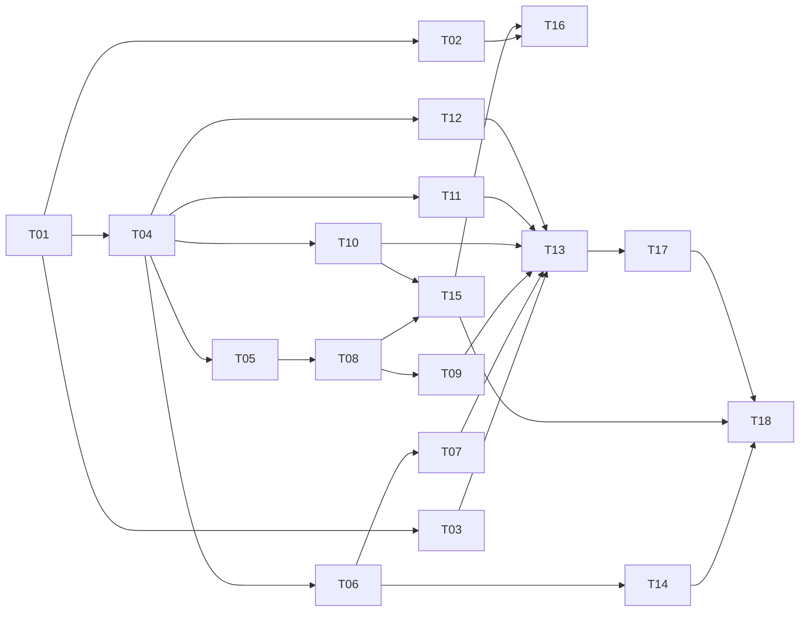

# baqueano: implementation plan

[DESIGN.md](DESIGN.md#plan-risks-and-open-decisions) splits the work into four phases with an exit criterion each. This document turns phase 1 into tasks I can hand to a coding agent (Codex or Claude Code) one at a time: each one fits in a single pull request, says what it depends on, which packages it touches, and when it's done. Phases 2 to 4 stay as an outline until phase 1 meets its criterion. I'd rather plan them with what I learn from the first one.

The rules for agents working on this repo are in [AGENTS.md](../AGENTS.md).

## Contents

1. [How I use this plan](#how-i-use-this-plan)
2. [What this plan settles](#what-this-plan-settles)
3. [Before any code: my part](#before-any-code-my-part)
4. [Phase 1 tasks](#phase-1-tasks)
5. [Order and parallel work](#order-and-parallel-work)
6. [Phase 1 exit](#phase-1-exit)
7. [Phases 2 to 4, in outline](#phases-2-to-4-in-outline)

## How I use this plan

- **One task, one branch, one pull request.** Branch `tNN-short-name`, PR title `TNN: what it does`. The PR ticks the task's box in this file.
- **A task starts when everything it depends on is merged.** Not before: two agents writing against a contract that isn't on `main` yet is how I get two incompatible versions of it.
- **"Done when" is the review checklist.** I copy it into the PR description and check each line before merging.
- **If a task turns out wrong or too big,** the agent stops and says so in the PR instead of improvising. I fix the plan, then the code.
- **Tasks marked are mine.** Reading terms, creating keys, deciding. An agent can prepare them but not close them.

## What this plan settles

The design leaves some details for "when I write phase 1", and a few code snippets in DESIGN.md are older than the text around them. These are the answers, so no agent has to guess:

| Topic                           | Decision                                                                                                                                                                                                                                                                                                                                                                                                                                                                                |
|---------------------------------|-----------------------------------------------------------------------------------------------------------------------------------------------------------------------------------------------------------------------------------------------------------------------------------------------------------------------------------------------------------------------------------------------------------------------------------------------------------------------------------------|
| Module and Go version           | `github.com/thomas-vilte/baqueano`, `go 1.27` in `go.mod` (the current stable release; `testing/synctest` needs 1.25 or later)                                                                                                                                                                                                                                                                                                                                                          |
| `Agent` vs `Run`                | The `Agent` snippet in DESIGN.md holds memory and budget in the struct. The text wins: `Agent` holds only what doesn't change between questions (models, tool registry, prompt, logger, tracer). Everything per question lives in a `Run`: budgets used, circuit breakers, documents seen, counters, memory. `Agent.Run(ctx, question)` creates one                                                                                                                                     |
| What `Run` returns              | `(Result, error)`. `Result` carries the report, its status (`complete`, `budget_exhausted`, `partial`), failed sources and usage. `error` is non-nil only when there's no report at all. The DESIGN.md test that expects `ErrBudgetExhausted` from `Run` is outdated: a run that hits a budget returns a forced report with status `budget_exhausted`, and the CLI exits with 2. `ErrBudgetExhausted` still exists, inside `Budget.Check`, to tell the loop why it's forcing the report |
| Where the typed errors live     | A leaf package, `internal/apierr`, with `ErrAuth`, `ErrRateLimited`, `ErrUnavailable` and `ErrBadRequest`, plus a helper that maps an HTTP status to one of them. Source clients and the model adapter both import it; neither imports the other                                                                                                                                                                                                                                        |
| The status line in tool results | "read so far: 14 documents from 3 threads" depends on the run, and tools are stateless, so the loop appends it after the tool returns, not the tool                                                                                                                                                                                                                                                                                                                                     |
| Token counting before a call    | The previous response's `usage.input_tokens` plus an estimate of what was appended since (4 characters per token). It's cheap, and it's exact at the start of every turn. If evals show it's off, I switch to the token counting endpoint                                                                                                                                                                                                                                               |
| How telemetry gets in           | Decorators: an instrumented `Model` and an instrumented `Tool` wrap the real ones, so `chat` and `execute_tool` spans need no code in the loop. Only `invoke_agent` and `verify_report` are created inside the agent, with a tracer passed to its constructor. No global providers                                                                                                                                                                                                      |
| Task runner                     | A `Makefile` with `test`, `lint`, `vuln`, `fmt`, `build` and `replay`. CI calls the same targets, so local and CI never drift                                                                                                                                                                                                                                                                                                                                                           |

## Before any code: my part

| ID | What                                                                                                     | Blocks                                  |
|----|----------------------------------------------------------------------------------------------------------|-----------------------------------------|
| H1 | Read the Stack Exchange API terms, confirm quotas, register an app key                                   | T14                                     |
| H2 | Create the Anthropic API key and set a monthly spending cap on the account                               | T13 (first live run)                    |
| H3 | Check Haiku 5.5 and Sonnet 5.5 prices on Anthropic's pricing page and write them into the default config | T10 (cost per call)                     |
| H4 | Protect `main`: pull requests only, CI required to merge                                                 | Before T01 merges                       |
| H5 | Decide whether recorded fixtures (Hacker News and Stack Exchange text) go in the repo or stay local      | T17 (committing fixtures, not the code) |
| H6 | Review the system prompt v1 before the first live run                                                    | T13                                     |

## Phase 1 tasks

Each task links to the part of the docs it implements. Those sections are the spec; the task card only adds scope and the done criteria.

### M0. Foundation

- [ ] **T01. Repo skeleton and CI**
  - Depends on: nothing.
  - Scope: `go.mod`; the package folders from the [repo layout](DESIGN.md#tool-design), each with a `doc.go`; `Makefile`; `.golangci.yml` (golangci-lint v2 format); `.gitignore` (`.env`, `bin/`, `cover.out`); `.env.example` with the variable names, no values; `.github/workflows/ci.yml` with the `lint`, `test`, `vuln` and `docker` jobs from [INFRA.md](INFRA.md#cicd). The `replay` job comes in T17.
  - Done when: `make lint test vuln` passes locally and in CI; `cmd/agent` builds and prints its version.

- [ ] **T02. Local stack**
  - Depends on: T01.
  - Scope: `deploy/compose/docker-compose.yml` with `grafana/otel-lgtm` at a pinned tag, the multi-arch `Dockerfile` and `.dockerignore`, as in [INFRA.md](INFRA.md#local-development-with-docker). Only the `lgtm` service; the `http` profile is phase 2.
  - Done when: `docker compose up lgtm` serves Grafana on `localhost:3000`, and `docker buildx build --platform linux/amd64,linux/arm64 .` builds.

- [ ] **T03. Configuration**
  - Depends on: T01.
  - Scope: `internal/config`. The struct matches the YAML in [DESIGN.md](DESIGN.md#configuration). `Load` applies the four layers (defaults, file, `BAQUEANO_*` variables, flag overrides passed in by the caller), `Validate` checks every rule listed there, and `Hash` computes `config_hash` without secrets ([INFRA.md](INFRA.md#configuration)). The package never reads `os.Args`; `cmd/agent` owns flags.
  - Done when: table tests cover every layer overriding the one below, an unknown YAML field fails, each validation rule has a failing case, and two configs that differ only in a secret have the same hash.

### M1. Contracts

This is the one task that has to land before the work splits in two. Everything after it codes against these types.

- [ ] **T04. Shared types and interfaces**
  - Depends on: T01.
  - Scope, types and tiny helpers only, no behavior:
    - `internal/apierr`: the four sentinels and `FromStatus(code int, err error) error`.
    - `internal/tools`: `Tool`, `Document` (with `Thread` and `Provenance`), `Result`, the `launch` and `thread_author` flags, and `Registry` (register, look up, list definitions).
    - `internal/agent`: `Message`, `Request` (including a forced `ToolChoice`), `Response` (with `StopReason`, `ToolCalls` and `Usage`), `ToolCall`, `ToolResult`, the `Model` and `Memory` interfaces, `Budget` and `ErrBudgetExhausted`, `Result` and `Status`.
    - `internal/report`: `Report`, `Problem`, `Evidence`, `Existing` and `Mentions`, as in [What the agent delivers](DESIGN.md#what-the-agent-delivers), plus the JSON Schema `submit_report` exposes.
  - Done when: everything compiles, `go vet` is clean, the `submit_report` schema has a test that a valid example passes and one without `Evidence` fails, and the import rules in [AGENTS.md](../AGENTS.md#how-the-code-is-written) hold.

### M2. The core, in parallel

- [ ] **T05. Report: validation, counts, rendering**
  - Depends on: T04.
  - Scope: `internal/report`. `Verify` checks that every ref in `Evidence`, `Existing` and any text field was seen in a tool result, and that every quote appears in that document's text after normalizing (Unicode NFC, whitespace, typographic quotes, HTML entities). `Count` computes `Mentions` and sorts problems by authors, then threads, then documents. `Markdown` and `JSON` render it. Spec: [REPORT-EXAMPLE.md](REPORT-EXAMPLE.md#what-my-code-adds) and [What validation rejects](REPORT-EXAMPLE.md#what-validation-rejects).
  - Done when: the hand-built example's `submit_report` input is a golden test that renders the same Markdown as REPORT-EXAMPLE.md (`-update` refreshes it); every rejection case in that doc has a test; `FuzzVerifyQuote` holds the property from [INFRA.md](INFRA.md#unit).

- [ ] **T06. HTTP client for sources**
  - Depends on: T04.
  - Scope: `internal/tools`. One client every source uses: host allowlist, a body size limit, a per-source rate limiter, up to 2 retries with backoff and jitter for 5xx and timeouts, `Retry-After` or `backoff` honored only if it fits before the context deadline, errors mapped through `apierr`, and a `RoundTripper` that strips `key=` and `access_token=` from URLs before logs or spans see them. Also the in-memory cache with TTL, keyed by the normalized request. Spec: [When something fails](DESIGN.md#when-something-fails).
  - Done when: `synctest` tests with an in-memory `RoundTripper` cover 200, 429 with `Retry-After` (inside and outside the deadline), 5xx then success, 5xx three times, broken JSON, a host outside the allowlist and a huge body. No real network.

- [ ] **T07. Hacker News source**
  - Depends on: T06.
  - Scope: `internal/sources/hackernews`. The Algolia client (search by stories or comments with the `since` filter; read an item with its tree) and the two tools, `search_hackernews` and `read_hackernews_thread`, with their JSON Schemas. Refs `hn:<id>`, `Thread` pointing at the root story, `launch` for Show HN and Launch HN, `thread_author` for comments by the story's author, snippets trimmed, at most `max_results_per_tool` documents and `Truncated` set. Spec: [Hacker News](DESIGN.md#hacker-news).
  - Done when: `httptest` tests run against JSON saved in `testdata/` (normal, empty, deleted comments, a deep thread), the flags are right in each, and a tool error is a message the model can act on.

- [ ] **T08. The loop**
  - Depends on: T04, T05.
  - Scope: `internal/agent`. `Agent` and `Run` as settled above. Budgets for turns, input tokens and time, checked before each turn; tools in parallel with `errgroup` and `SetLimit(4)`; a per-tool timeout; an unknown tool or a failing tool becomes `is_error: true`; the status line appended to tool results; the index of documents seen; the forced report (`tool_choice` on `submit_report`) when a budget runs out or the model stops without a report; `report.Verify` and `report.Count` on the submitted report. Spec: [The agent loop](DESIGN.md#the-agent-loop) and [How I write it in Go](DESIGN.md#how-i-write-it-in-go). A pass-through `Memory` is enough for this task's tests.
  - Done when: a scripted fake `Model` (`[]Step{ToolUse(...), SubmitReport(...)}`) covers a normal run, two tools in one turn, each budget running out (status `budget_exhausted`), an unknown tool, a hanging tool, an invalid `submit_report` and a model that never calls it. All with `-race`.

- [ ] **T09. Loop: failures and two stages**
  - Depends on: T08.
  - Scope: `internal/agent`. A circuit breaker per source inside each `Run` (opens after 3 failures in a row, stays open for the run, calls fail at once); `ErrAuth` from a source disables it for the run; `partial` status and `failed_sources`; `max_tokens` handled with one forced retry; "request too large" compacts once through `Memory`, then forces the report; a separate report model, as in [How I get good reports](DESIGN.md#how-i-get-good-reports). Every row of [diagram 08](diagrams/08-failures.png) maps to code.
  - Done when: each row of the two failure tables in [When something fails](DESIGN.md#when-something-fails) has a test, the breaker test uses `synctest`, and a run with different research and report models sends the report call to the second one with the same messages.

- [ ] **T10. Anthropic adapter**
  - Depends on: T04, H3.
  - Scope: `internal/model/anthropic`. Implements `Model` with `anthropic-sdk-go`: SDK retries set to 0; the adapter's own retries for 429 and 529 honoring `Retry-After`; errors mapped to `apierr`; forced `tool_choice`; usage and cost per call from the configured prices. The SDK's types never leave the package.
  - Done when: `httptest` tests (pointing the SDK's base URL at the test server) cover a tool use response, a forced `submit_report`, `max_tokens`, 401, 429 then success, 529 until the deadline and a 400, and none of them retries more than the adapter says.

- [ ] **T11. Memory**
  - Depends on: T04.
  - Scope: `internal/memory`. Working context: `Messages` returns what fits in `maxTokens` by shrinking results of threads already read to title, ref and one line, and compacting through a summarizer function as the last resort. Session memory: `EndTurn` keeps the question and its report, and the next question starts from them. Spec: [Memory and context management](DESIGN.md#memory-and-context-management).
  - Done when: tests show the limit is respected, no ref ever disappears after shrinking or compacting, the tool use and tool result pairs stay intact (the API rejects an orphan), and a follow-up question starts with the previous report.

- [ ] **T12. System prompt v1**
  - Depends on: T04.
  - Scope: `prompts/system.md` with the text from [System prompt](DESIGN.md#system-prompt), embedded with `go:embed`, and its version exposed for `prompt_version`.
  - Done when: a test checks the prompt is embedded and the version is not empty. H6 is the real review.

### M3. First end-to-end run

- [ ] **T13. CLI**
  - Depends on: T03, T07, T08, T09, T10, T11, T12, H2.
  - Scope: `cmd/agent`. Flags, config, wiring (Hacker News only for now), Markdown to stdout and `--json`, exit codes 0, 2 and 1, `signal.NotifyContext`, logs to stderr. `init` writes a config with only Hacker News on; `doctor` validates the config and checks the model key and each enabled source with one cheap call.
  - Done when: `go run ./cmd/agent "what problems do people have with Terraform state?"` prints a report with 100% valid citations, Ctrl+C cancels cleanly, and `doctor` reports a bad key without asking a question.

This is the first milestone that matters: a real question with a real answer. Everything after it makes it better or observable.

### M4. Second source

- [ ] **T14. Stack Exchange source**
  - Depends on: T06, H1.
  - Scope: `internal/sources/stackexchange`. API 2.3: search with `/search/advanced` over the configured sites, read a question with its answers, the key from `STACKEXCHANGE_KEY`, `quota_remaining` and `backoff` mapped to `ErrRateLimited`. Tools `search_stackexchange` and `read_stackexchange_question`. Spec: [Stack Exchange](DESIGN.md#stack-exchange). Registered in the CLI in the same PR.
  - Done when: `httptest` tests cover several sites, a `backoff` field, a quota at zero and gzip responses, and a live run uses both sources.

### M5. Observability

- [ ] **T15. Telemetry**
  - Depends on: T08, T10.
  - Scope: `internal/telemetry`. Providers for traces, metrics and logs configured from the standard `OTEL_*` variables; the instrumented `Model` and `Tool` decorators; the `invoke_agent` and `verify_report` spans; the attributes in [Span attributes](INFRA.md#span-attributes) and the phase 1 metrics in [Metrics](INFRA.md#metrics); slog fanned out to `otelslog`; `Shutdown` with a 3-second cap. The GenAI semconv version is pinned and named in the code. Nothing writes to stdout.
  - Done when: a scripted run under `tracetest.NewSpanRecorder()` produces `invoke_agent`, N `chat` and the `execute_tool` spans with the required attributes and none of the forbidden ones; a test checks every metric's attributes against the allowlist; a live run shows up in Grafana.

- [ ] **T16. Grafana dashboard**
  - Depends on: T02, T15.
  - Scope: `deploy/grafana/dashboards/baqueano-run.json`, provisioned into `otel-lgtm`: runs by status, cost per run, tokens by stage, tool calls by outcome, errors per source, a link from a run to its trace.
  - Done when: `docker compose up lgtm` plus one live run fills every panel.

### M6. Recording and closing the phase

- [ ] **T17. Recording and replay**
  - Depends on: T13.
  - Scope: the recording `RoundTripper` behind `--record <dir>` for sources and the model, with normalized inputs, redaction and a strict replay mode that fails on a missing fixture, as in [Recording and replaying](EVALS.md#recording-and-replaying). A replay test of a whole run, and the `replay` job in CI.
  - Done when: one case recorded live replays offline with no API key, the same report comes out, and no key appears anywhere in the fixtures.

- [ ] **T18. The phase 1 cases** with an agent's help
  - Depends on: T14, T15, T17.
  - Scope: the 5 cases from [The phase 1 set](EVALS.md#the-phase-1-set) in `evals/cases/`, each run live with `--record`, and each report checked against [What makes a report useful](REPORT-EXAMPLE.md#what-makes-a-report-useful).
  - Done when: it meets the phase 1 exit below.

## Order and parallel work

The arrows are "depends on". With two agents, everything at the same level can run at once.

How I'd split it between Codex and Claude Code. Each lane owns its packages, so the two never touch the same files at the same time:

| Step | Lane A: agent core | Lane B: sources and edges |
|------|--------------------|---------------------------|
| 1    | T01                | (waits)                   |
| 2    | T04                | T02, then T03             |
| 3    | T05                | T06                       |
| 4    | T08                | T07                       |
| 5    | T09                | T10, then T12             |
| 6    | T11                | T14 (if H1 is done)       |
| 7    | T13                | T15                       |
| 8    | T17                | T16                       |
| 9    | T18, with me       |                           |

T04 goes to one agent alone, and I review it before anything else starts: every later task builds on those types, and changing them afterwards touches every package.

## Phase 1 exit

From [DESIGN.md](DESIGN.md#plan-risks-and-open-decisions): the 5 phase 1 cases give useful reports per the checklist, with 100% valid citations. On top of that, before calling it done:

- CI green on `main`: lint, `-race` tests, `govulncheck`, replay and the Docker build.
- One trace per case in Grafana, with cost per run.
- The open decisions in DESIGN.md that phase 1 answers are ticked or moved to phase 2 with a reason.

## Phases 2 to 4, in outline

I break each one into tasks when the previous one exits, with this same format.

| Phase               | Main blocks, in order                                                                                                                                                                                                                 |
|---------------------|---------------------------------------------------------------------------------------------------------------------------------------------------------------------------------------------------------------------------------------|
| 2. Sources          | MCP server over stdio with the source tools (in-memory transport tests first) → `run_research` and `add_document` → GitHub → Brave (`record: false`) → manual input → Discourse. Each new source starts with a task to read its terms |
| 3. Evals and memory | Eval runner over the fixtures → hard checks → judge and its calibration → the full 25 cases → Haiku alone vs Haiku plus Sonnet → working notes → prompt caching → external sources over MCP                                           |
| 4. Deploy           | Terraform bootstrap → Lambda adapter and its tests → SSM and S3 → Function URL with the bearer token → `infra.yml` with OIDC → Grafana Cloud → published eval results                                                                 |
